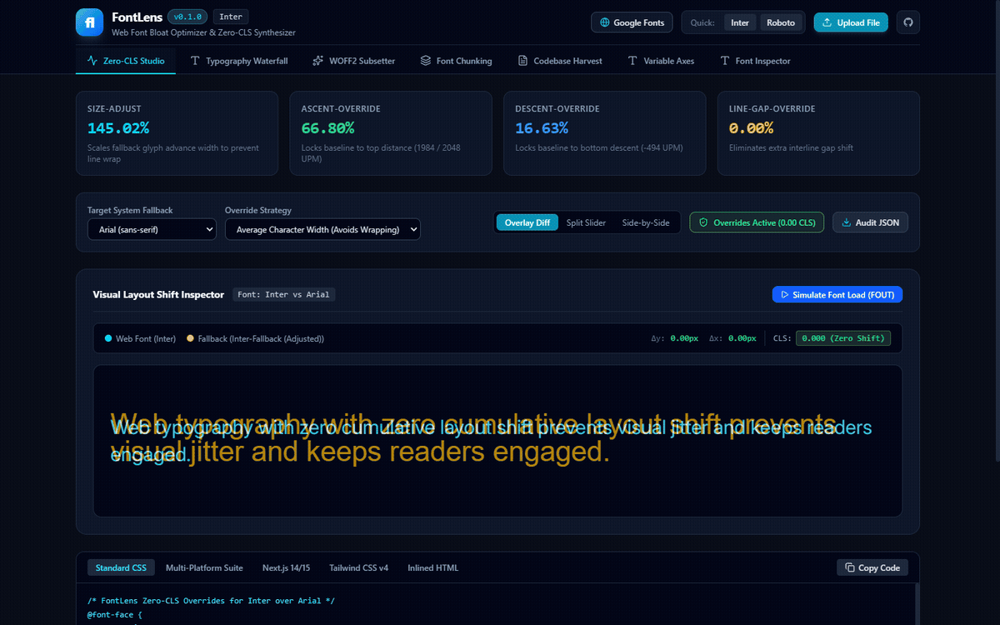
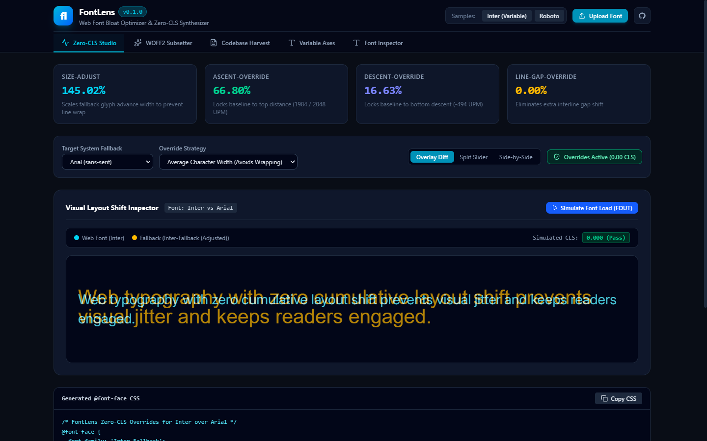
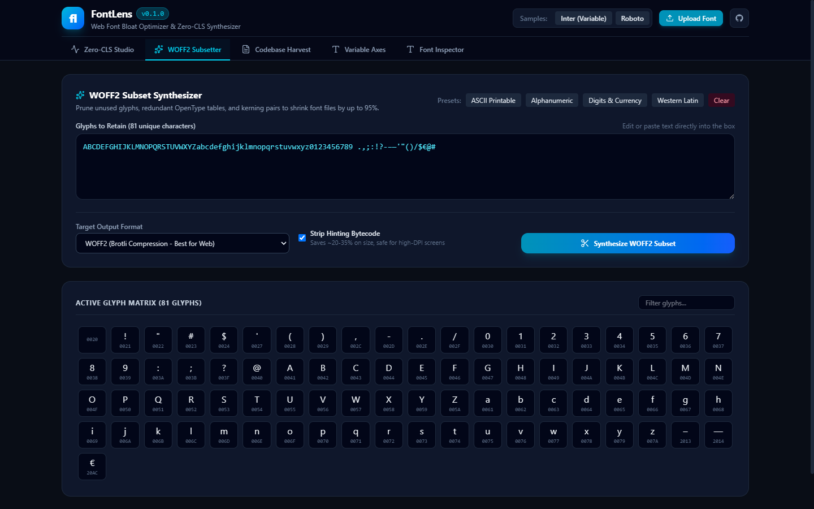
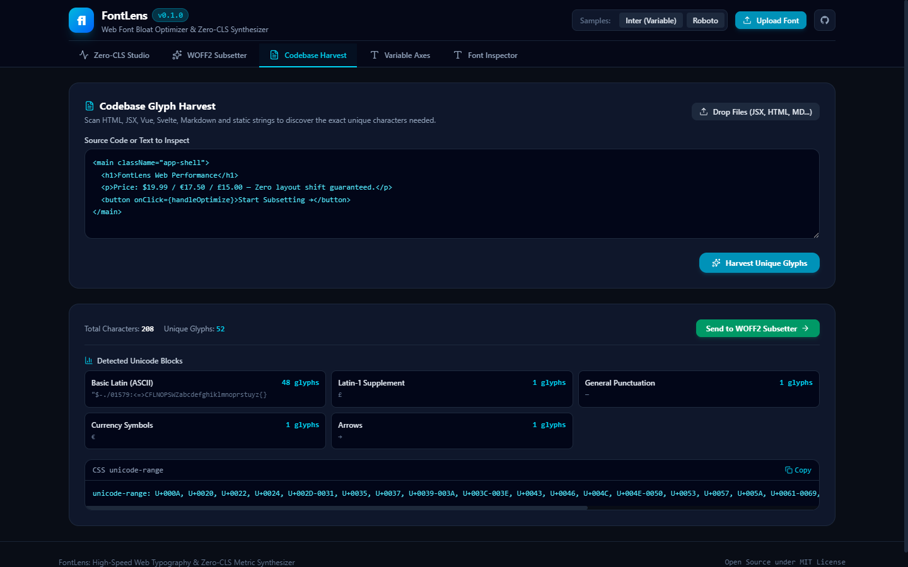
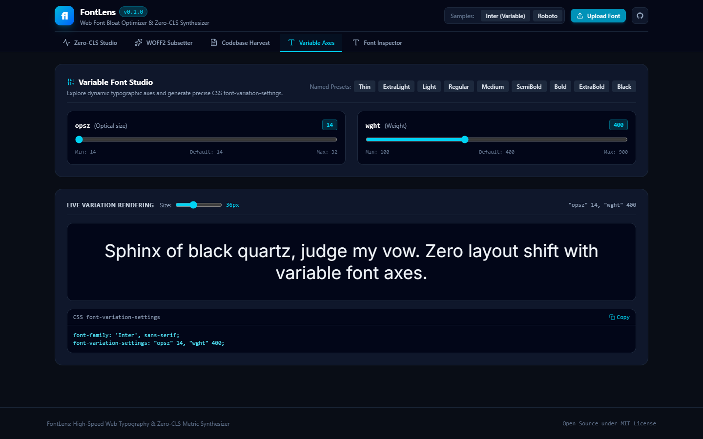

# FontLens

Web font bloat optimizer, glyph subset synthesizer, and zero-CLS metric overrides generator.

<p align="center">
  
</p>

## The Problem

Web fonts frequently degrade Core Web Vitals, specifically Largest Contentful Paint (LCP) and Cumulative Layout Shift (CLS):
1. **Bandwidth Bloat**: Production sites commonly load 200 KB to 500 KB `.woff2` files containing thousands of unused glyphs (such as Cyrillic, Greek, mathematical symbols, or unneeded diacritics) for interfaces that only render standard Latin characters.
2. **Cumulative Layout Shift**: When a browser swaps from a system fallback font (such as Arial or Georgia) to a loaded web font, text geometry changes. Variations in character widths cause lines to wrap differently, and mismatched vertical metrics trigger visual jumps on screen.

FontLens eliminates both issues by extracting exact codebase glyphs, synthesizing trimmed WOFF2 subsets, and calculating mathematical `@font-face` metric overrides for system fonts.

---

## Core Capabilities

- **Codebase Glyph Harvest**: Scans HTML, JSX, TSX, Vue, Svelte, Astro, Markdown, and JSON files to extract the exact list of unique characters used in a project. Produces optimized CSS `unicode-range` strings.
- **WOFF2 Subset Synthesizer**: Uses `fontTools` and Brotli compression to strip unneeded glyphs, unreferenced kerning pairs, and legacy OpenType tables (`gasp`, `VDMX`, `LTSH`, `hdmx`, `DSIG`). Shrinks font payloads from 300+ KB down to 10-15 KB.
- **Zero-CLS Metric Overrides**: Reads font coordinate metrics from `OS/2`, `hhea`, and `head` tables. Computes exact mathematical ratios for `size-adjust`, `ascent-override`, `descent-override`, and `line-gap-override` against system fonts (`Arial`, `Roboto`, `Georgia`, `Segoe UI`, `system-ui`).
- **Variable Font Slicing**: Inspects `fvar` design axes (`wght`, `opsz`, `wdth`, `slnt`) and allows clamping ranges (for example, pinning weight to 400-700) to strip variation deltas outside target design bounds.
- **Visual Studio**: Web application with real-time layout shift comparison, FOUT simulation, glyph matrices, and vector outline rendering.

---

## Interactive Studio Screenshots

| Zero-CLS Studio (Live A/B Diff) | WOFF2 Subsetter & Matrix |
| :---: | :---: |
|  |  |

| Codebase Glyph Harvest | Variable Axes Studio |
| :---: | :---: |
|  |  |

---

## Mathematical Formulation of Metric Overrides

To achieve zero layout shift, the fallback font must match the web font's advance width and vertical bounding box.

### 1. Horizontal Scale (size-adjust)

Matching character widths prevents line-wrapping differences:

$$S = \frac{\text{WebAvgCharWidth} / \text{WebUPM}}{\text{FallbackAvgCharWidth} / \text{FallbackUPM}}$$

$$\text{size-adjust} = S \times 100\%$$

### 2. Vertical Box Alignment

Because `size-adjust` scales fallback coordinates by $S$, overrides divide by $S$ so the net rendered height equals the web font:

$$\text{ascent-override} = \frac{\text{WebAscent} / \text{WebUPM}}{S} \times 100\%$$

$$\text{descent-override} = \frac{|\text{WebDescent}| / \text{WebUPM}}{S} \times 100\%$$

$$\text{line-gap-override} = \frac{\text{WebLineGap} / \text{WebUPM}}{S} \times 100\%$$

Detailed derivations and table selection rules appear in [docs/METRICS_MATHEMATICS.md](docs/METRICS_MATHEMATICS.md).

---

## Quickstart

### Installation

Requires Python 3.10+.

```bash
git clone https://github.com/alexandrmotologa/fontlens.git
cd fontlens
python -m venv .venv
source .venv/bin/activate  # On Windows: .venv\Scripts\activate
pip install -e .
```

### Command Line Usage

#### 1. Harvest Used Characters

```bash
# Scan source directory and save characters
fontlens harvest ./src ./public -o used-glyphs.txt
```

#### 2. Synthesize WOFF2 Subset

```bash
# Subset a font using scanned project characters
fontlens subset Inter-Variable.ttf --scan ./src/ -o dist/fonts/Inter.subset.woff2 --no-hinting
```

#### 3. Compute Zero-CLS Overrides

```bash
# Generate overrides against Arial
fontlens metrics Roboto.ttf --fallback Arial
```

Output:

```css
@font-face {
  font-family: 'Roboto-Fallback';
  src: local('Arial');
  ascent-override: 81.80%;
  descent-override: 21.16%;
  line-gap-override: 0.00%;
  size-adjust: 128.10%;
}

:root {
  --font-primary: 'Roboto', 'Roboto-Fallback', sans-serif;
}

body {
  font-family: var(--font-primary);
}
```

#### 4. Launch Interactive Web Studio

```bash
fontlens studio --port 8000
```

Open `http://127.0.0.1:8000` in a browser.

---

## System Fallback Fonts Supported

FontLens includes verified OpenType metrics and local OS font discovery for:

- **Sans-Serif**: `Arial`, `Helvetica`, `Segoe UI`, `Roboto`, `Verdana`, `Trebuchet MS`, `system-ui`
- **Serif**: `Georgia`, `Times New Roman`
- **Monospace**: `Consolas`, `Menlo`, `Courier New`

---

## Documentation

- [Font Metric Mathematics and Zero CLS Derivation](docs/METRICS_MATHEMATICS.md)
- [Web Font Subsetting and OpenType Table Pruning](docs/SUBSETTING_GUIDE.md)
- [Command Line Reference and Options](docs/CLI_USAGE.md)

---

## License

MIT License. Authored by Alexandr Motologa.
